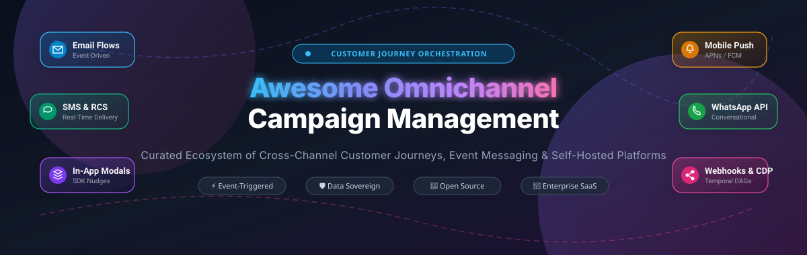

# 🚀 Awesome Omnichannel Campaign Management

<p align="center">
  
</p>

<p align="center">
  <a href="https://github.com/ishandutta2007/Awesome-Awesome-Awesome"></a>
  <a href="https://discord.gg/jc4xtF58Ve"></a>
  <a href="https://github.com/ishandutta2007/Awesome-Omnichannel-Campaign-Management/stargazers"></a>
  <a href="https://github.com/ishandutta2007/Awesome-Omnichannel-Campaign-Management/network/members"></a>
  <a href="https://github.com/ishandutta2007/Awesome-Omnichannel-Campaign-Management/issues"></a>
  <a href="https://github.com/ishandutta2007/Awesome-Omnichannel-Campaign-Management/blob/main/LICENSE"></a>
  <a href="https://github.com/ishandutta2007"></a>
</p>

---

## 📖 Table of Contents
- [🎯 Overview & Architecture](#-overview--architecture)
- [📊 Sector Overview & Market Dynamics](#-sector-overview--market-dynamics)
- [🏢 Enterprise & SaaS Platforms (Comparison Table)](#-enterprise--saas-platforms-comparison-table)
- [⚡ Open-Source & Self-Hosted Solutions (Ranked by Stars)](#-open-source--self-hosted-solutions-ranked-by-stars)
- [🔍 Architectural Trade-Offs: Self-Hosted vs. SaaS](#-architectural-trade-offs-self-hosted-vs-saas)
- [🛠️ Key Evaluation Criteria](#️-key-evaluation-criteria)
- [🤝 How to Contribute](#-how-to-contribute)
- [📈 Star History](#-star-history)
- [💖 Support & Community](#-support--community)
- [📄 License & Disclaimer](#-license--disclaimer)

---

## 🎯 Overview & Architecture

**Omnichannel Campaign Management (OCM)** enables engineering, product, and growth teams to design, automate, and orchestrate complex customer journeys across digital touchpoints: **Email, SMS, Mobile Push (APNs/FCM), In-App Messages, WhatsApp, RCS, Web Push, and Webhooks**.

Rather than managing disconnected single-channel silos, modern omnichannel platforms ingest real-time product events (via CDPs, SDKs, or Kafka/Postgres streams), evaluate behavioral segments, and trigger unified multi-step communication flows with guaranteed deliverability, time-window constraints, and conversion attribution.

```
       [ User Events & Product Activity ]
       ( Webhooks / SDKs / Segment / Kafka )
                         │
                         ▼
   ┌──────────────────────────────────────────────┐
   │    Omnichannel Journey & Campaign Engine     │
   │  • Event Stream Processor (Temporal / Redis) │
   │  • Behavioral Segmentation & CDP Sync        │
   │  • Branching Conditions & Frequency Caps     │
   └──────────────────────┬───────────────────────┘
                          │
     ┌────────────┬───────┴─────┬────────────┬────────────┐
     ▼            ▼             ▼            ▼            ▼
 📧 Email      📱 SMS/RCS    🔔 Push     💬 WhatsApp   🪟 In-App
(SES/SendGrid) (Twilio/Vonage) (APNs/FCM)  (Meta API)    (Native SDK)
```

---

## 📊 Sector Overview & Market Dynamics

The global **Omnichannel Campaign Management & Marketing Automation** market was estimated at **$9.2 Billion in 2024** and is projected to reach **$22.5 Billion by 2030**, advancing at a robust compound annual growth rate (**CAGR of ~16.2%**).

The sector is **moderately fragmented**:
- **Enterprise Suites (Concentrated Top End)**: Legacy enterprise titans such as **Salesforce Marketing Cloud** and **Adobe Campaign** dominate high-touch global enterprise and banking contracts, where multi-million-dollar multi-year commitments and deep legacy CRM integrations are standard.
- **Modern Cloud Engines (Competitive Mid-Market)**: High-growth digital-first platforms like **Klaviyo, Braze, Iterable, and Customer.io** capture the fastest-growing mobile and e-commerce scaleups by offering superior visual journey builders, real-time SDKs, and developer-friendly event APIs.
- **Data-Sovereign Open-Source Wave (Fragmented & Growing)**: Due to escalating per-profile SaaS costs and stringent privacy mandates (**GDPR, CCPA, HIPAA**), engineering teams are aggressively shifting toward self-hosted solutions like **Novu, Chatwoot, Mautic, and Dittofeed**, allowing companies to orchestrate millions of contacts without data egress fees or vendor lock-in.

---

## 🏢 Enterprise & SaaS Platforms (Comparison Table)

Below is a detailed comparison of market-leading SaaS omnichannel campaign management suites, **sorted in descending order by company size (valuation / revenue)**.

| 🏢 Platform | 💰 Company Valuation / Revenue | 🏷️ Starting Tier Pricing | 🎁 Free Tier / Trial Limits | 📡 Key Channels & Strengths |
| :--- | :--- | :--- | :--- | :--- |
| [**Salesforce Marketing Cloud**](https://www.salesforce.com/products/marketing-cloud/overview/) | **~$290 Billion** (Market Cap: NYSE: CRM) / **~$34.9B** Annual Revenue | **$1,500/month** (billed annually for Marketing Cloud Growth Edition, up to 10,000 contacts; B2C Engagement+ starts at $2,000/month) | **30-day free trial** via Salesforce Starter/Growth suite (up to 2,500 contacts, core email & marketing automation workflows; no free-forever plan) | 📧 Email, 📱 SMS, 🔔 Push, 💬 WhatsApp, 🎯 Ad Studio, 🤖 Einstein AI personalization, unified Data Cloud CRM sync |
| [**Adobe Campaign**](https://business.adobe.com/products/campaign/adobe-campaign.html) | **~$220 Billion** (Market Cap: NASDAQ: ADBE) / **~$21.4B** Annual Revenue | **~$2,500 to $4,000/month** ($30,000 to $80,000/year minimum contract based on active profile tier e.g. 50,000 profiles, annual commitment) | **30-day sales-guided sandbox proof-of-concept** environment (up to 10,000 test profiles and 50,000 test emails; no self-serve free-forever tier) | 📧 Email, 📱 SMS, 🔔 Mobile Push, 📬 Direct Mail, 📞 Call Center, 🎨 Adobe Experience Platform & Journey Optimizer |
| [**Klaviyo**](https://www.klaviyo.com/) | **~$9.2 Billion** (Market Cap: NYSE: KVYO) / **~$936M** Annual Revenue | **$20/month** (for up to 500 contacts and 5,000 email sends/month; SMS add-on starts at $15/month for 1,250 SMS credits) | **Free-forever plan**: up to 250 contacts, 500 email sends/month, 150 free SMS/MMS credits, built-in segmentation, and automation flows | 📧 Email, 📱 SMS/MMS, 🔔 Mobile Push, 🛒 Shopify/WooCommerce native integration, predictive customer lifetime value (CLV) |
| [**Braze**](https://www.braze.com/) | **~$3.6 Billion** (Market Cap: NASDAQ: BRZE) / **~$590M** Annual Revenue | **~$2,500 to $4,166/month** (billed annually as $30,000 to $50,000/year minimum contract for entry growth packages up to 25,000 MAU) | **14-day sales-provisioned sandbox trial** (or **4 months free** via Braze for Startups program for early-stage VC-backed startups with <$5M raised; no self-serve free plan) | 🔔 Mobile Push, 🪟 In-App Messages, 📇 Content Cards, 📧 Email, 📱 SMS/MMS, 💬 WhatsApp, ⚡ Real-time Braze Currents data stream |
| [**Iterable**](https://iterable.com/) | **~$3.4 Billion** (Series E Unicorn Valuation) / **~$160M** ARR | **~$3,000 to $4,000/month** (~$36,000 to $48,000/year minimum commitment based on Monthly Active Profiles) | **14 to 30-day guided proof-of-concept sandbox** via enterprise sales demo (scoped to 5,000 test profiles and 25,000 test sends; no self-serve free tier) | 📧 Email, 🔔 Mobile Push, 📱 SMS, 🪟 In-App, 🌐 Web Push, 🧩 Embedded Messages, 🤖 Journey Assist AI workflow optimizer |
| [**Brevo**](https://www.brevo.com/) *(formerly Sendinblue)* | **~$1.1 Billion** (Centaur Private Valuation) / **~$140M** Annual Revenue | **$9/month** (Starter tier for 5,000 emails/month with no daily cap; Business tier with automated multi-channel journeys starts at $18/month) | **Free-forever plan**: unlimited contacts, up to 300 emails/day (9,000 emails/month), transactional email API, and core automation workflows | 📧 Email, 📱 SMS, 💬 WhatsApp, 💬 Live Chat & Webchat, 🌐 Web Push, 📢 Facebook Ads, 📇 Integrated Sales CRM |
| [**Customer.io**](https://customer.io/) | **~$600 Million** (Private Valuation) / **~$65M** ARR | **$100/month** (Essentials plan for up to 5,000 profiles, 1,000,000 emails/month, 2 workspaces, visual workflow builder) | **14-day free trial** with full platform access, up to 5,000 total messages across channels, and 50 test messages/day (no credit card required; no free-forever tier) | 📧 Email, 📱 SMS, 🔔 Mobile Push, 🪟 In-App, 🪝 Webhooks, 💬 Slack notifications, 🎯 Ad Audience Sync, behavioral event triggers |
| [**MoEngage**](https://www.moengage.com/) | **~$500 Million** (Series E Valuation) / **~$60M** ARR | **$300/month** (Growth tier for up to 10,000 MAU across push, email, SMS, and in-app channels) | **Free Starter plan (free forever)**: up to 10,000 MAUs, 10,000 emails/month, basic web/mobile push campaigns, and custom events | 🔔 Mobile Push, 🌐 Web Push, 📧 Email, 📱 SMS, 💬 WhatsApp, 🪟 In-App Nudges, 📊 Sherpa AI automated predictive journey flows |

---

## ⚡ Open-Source & Self-Hosted Solutions (Ranked by Stars)

Self-hosting your campaign management stack guarantees **100% data sovereignty**, protects sensitive customer PII from external vendors, and eliminates exorbitant per-subscriber or per-MAU subscription markup.

The projects below are **sorted in descending order by GitHub Stars_Count**:

### 1. [Novu](https://github.com/novuhq/novu) [](https://github.com/novuhq/novu/stargazers)
- **Primary Focus**: 🌐 Open-Source Notification & Multi-Channel Workflow Orchestration
- **Supported Channels**: 📧 Email, 📱 SMS, 🔔 Mobile Push, 🪟 In-App Notification Center, 💬 Chat (Slack, Discord, MS Teams, WhatsApp)
- **Key Features**: Visual notification workflow builder, multi-channel digest engine, channel step conditions, time delays, and drop-in embeddable notification center components for React, Vue, Angular, and Vanilla JS.
- **Tech Stack**: TypeScript, NestJS, Redis, MongoDB, Docker.
- **Ideal For**: Engineering teams building in-app notification centers and unified programmatic cross-channel triggers across diverse providers.

### 2. [Chatwoot](https://github.com/chatwoot/chatwoot) [](https://github.com/chatwoot/chatwoot/stargazers)
- **Primary Focus**: 💬 Open-Source Customer Engagement Suite & Omnichannel Desk
- **Supported Channels**: 🌐 Live Chat, 📧 Email, 💬 WhatsApp Business, 📱 SMS, 📘 Facebook Messenger, 📸 Instagram, 🐦 Twitter/X, ✈️ Telegram
- **Key Features**: Omnichannel shared inbox, automated conversation routing, canned responses, proactive live-chat campaigns, custom attribute tracking, and webhook triggers.
- **Tech Stack**: Ruby on Rails, Vue.js, PostgreSQL, Redis.
- **Ideal For**: Teams needing an open-source alternative to Intercom, Zendesk, and Drift combining inbound conversational support with proactive engagement campaigns.

### 3. [Listmonk](https://github.com/knadh/listmonk) [](https://github.com/knadh/listmonk/stargazers)
- **Primary Focus**: 🚀 High-Performance Self-Hosted Newsletter, Mailing & Transactional Messaging Manager
- **Supported Channels**: 📧 Email, 📱 SMS, 💬 WhatsApp / Telegram / Custom HTTP Messengers
- **Key Features**: Capable of sending tens of thousands of messages per minute with tiny CPU and memory footprints. Features dynamic segmentation with SQL expressions, transactional API triggers, multi-threaded sending queues, and subscriber self-service portals.
- **Tech Stack**: Go (Golang), PostgreSQL, Vue.js.
- **Ideal For**: High-throughput message delivery to millions of subscribers on minimal self-hosted infrastructure.

### 4. [Mautic](https://github.com/mautic/mautic) [](https://github.com/mautic/mautic/stargazers)
- **Primary Focus**: 🏛️ Veteran Open-Source Marketing Automation Suite (GPL-3.0)
- **Supported Channels**: 📧 Email, 📱 SMS, 🌐 Web Push, 📄 Dynamic Web Content, 🪟 Popups & Forms
- **Key Features**: Mature drag-and-drop campaign builder, lead scoring, contact lifecycle staging, automated drip nurturing, landing pages, asset tracking, and extensive CRM plugin integrations.
- **Tech Stack**: PHP, Symfony, MySQL/MariaDB, Doctrine.
- **Ideal For**: Organizations needing a fully-featured, community-governed alternative to HubSpot, Marketo, or Salesforce Pardot with no artificial contact caps.

### 5. [Plunk](https://github.com/useplunk/plunk) [](https://github.com/useplunk/plunk/stargazers)
- **Primary Focus**: 📨 Modern Open-Source Email Marketing & Automation Platform
- **Supported Channels**: 📧 Email (Transactional, Broadcasts, and Automated Workflows)
- **Key Features**: Visual drag-and-drop workflow canvas, event-triggered action sequences, delay steps, contact filtering, and direct routing through your own AWS SES account for rock-bottom delivery pricing ($0.10 per 1,000 emails).
- **Tech Stack**: TypeScript, Node.js, Prisma, PostgreSQL, Next.js.
- **Ideal For**: SaaS founders and developers wanting a sleek, self-hosted Customer.io email workflow alternative with native AWS SES infrastructure.

### 6. [erxes](https://github.com/erxes/erxes) [](https://github.com/erxes/erxes/stargazers)
- **Primary Focus**: 🏢 Open-Source Experience Operating System (XOS) & Growth Suite
- **Supported Channels**: 📧 Email, 📱 SMS, 🌐 Live Chat, 🪟 In-App Forms, 💬 Social Messengers
- **Key Features**: All-in-one suite combining CRM, omnichannel marketing automation, pipeline management, team inbox, lead capture widgets, and modular plugin architecture.
- **Tech Stack**: TypeScript, Node.js, React, GraphQL, MongoDB, Redis, RabbitMQ.
- **Ideal For**: Businesses wanting a single modular open-source platform replacing both HubSpot CRM and marketing automation.

### 7. [Dittofeed](https://github.com/dittofeed/dittofeed) [](https://github.com/dittofeed/dittofeed/stargazers)
- **Primary Focus**: ⚡ Open-Source Customer Engagement & Event-Driven Journey Engine (Customer.io Alternative)
- **Supported Channels**: 📧 Email, 📱 SMS, 🔔 Mobile Push, 💬 WhatsApp, 🪝 Custom Webhooks
- **Key Features**: Segment-driven automated journeys built in a visual editor; real-time event segmentation computed directly on your own ClickHouse event database. Durable execution powered by **Temporal**, ensuring long-running multi-week customer journeys never drop state.
- **Tech Stack**: TypeScript, Node.js, ClickHouse (analytics/segments), PostgreSQL (app state), Temporal (durable workflows).
- **Ideal For**: Engineering-led organizations looking for a self-hosted Customer.io alternative where all user PII and event clickstreams remain strictly on-premise.

### 8. [Laudspeaker](https://github.com/laudspeaker/laudspeaker) [](https://github.com/laudspeaker/laudspeaker/stargazers)
- **Primary Focus**: 📢 Open-Source Braze & Customer.io Alternative (YC Backed)
- **Supported Channels**: 📧 Email, 📱 SMS, 🔔 Firebase Mobile Push, 💬 Slack notifications
- **Key Features**: Visual no-code journey builder with branching, time windows, and delays. Native **PostHog plugin** for immediate integration with product analytics, database sync (Postgres, CSV), and user segment condition builders.
- **Tech Stack**: TypeScript, Node.js, Express, PostgreSQL, Redis.
- **Ideal For**: Product and growth teams using PostHog who want automated multi-step user onboarding and drip campaigns without per-contact pricing.

### 9. [Keila](https://github.com/pentacent/keila) [](https://github.com/pentacent/keila/stargazers)
- **Primary Focus**: 🔒 Privacy-First Self-Hosted Newsletter & Campaign Tool
- **Supported Channels**: 📧 Email
- **Key Features**: Strict GDPR compliance, clean Markdown/Block editor, customizable subscription widgets, advanced contact segmentation using JSON queries, and detailed campaign delivery metrics.
- **Tech Stack**: Elixir, Phoenix Framework, PostgreSQL.
- **Ideal For**: Developers and privacy-conscious organizations wanting an independent, reliable newsletter tool without third-party tracking pixels.

### 10. [SendPortal](https://github.com/mettle/sendportal) [](https://github.com/mettle/sendportal/stargazers)
- **Primary Focus**: 📬 Self-Hosted Email Marketing Automation
- **Supported Channels**: 📧 Email
- **Key Features**: Multi-tenant workspace management, subscriber tag segmentation, automated email campaign delivery, and native integrations with transactional SMTP/API providers (AWS SES, SendGrid, Mailgun, Postmark, Mailjet).
- **Tech Stack**: PHP, Laravel, MySQL / PostgreSQL, Vue.js.
- **Ideal For**: Agencies and marketing teams running multiple subscriber lists who want to manage self-hosted campaigns with low-cost SMTP providers.

### 11. [Parcelvoy](https://github.com/parcelvoy/platform) [](https://github.com/parcelvoy/platform/stargazers)
- **Primary Focus**: 📦 Open-Source Multi-Channel Marketing Automation (Braze Alternative)
- **Supported Channels**: 📧 Email, 📱 SMS, 🔔 Mobile Push, 🪝 Webhooks
- **Key Features**: Visual flow builder for complex customer journeys, event tracking, real-time message personalization, and multi-provider delivery routing.
- **Tech Stack**: TypeScript, Node.js, PostgreSQL, Redis.
- **Ideal For**: Teams looking for a lightweight, modern open-source marketing automation engine with full control over customer data.

---

### 🌟 Notable Specialized Self-Hosted Frameworks

- **[Helio](https://github.com/Helio-Cloud)** — AI-native, data-sovereign customer data platform (CDP) and growth platform. Features Segment/RudderStack-compatible HTTP tracking APIs, visual journey DAGs built on React Flow, and durable workflow execution on Temporal.
- **Kling.to** — Self-hosted marketing automation platform tailored for e-commerce with visual automation flows for abandoned cart recovery, post-purchase sequences, and native Shopify/WooCommerce connectors.

---

## 🔍 Architectural Trade-Offs: Self-Hosted vs. SaaS

| Dimension | 🏢 Enterprise SaaS (Braze, Customer.io, Klaviyo) | ⚡ Self-Hosted (Dittofeed, Novu, Mautic, Listmonk) |
| :--- | :--- | :--- |
| **Data Sovereignty & Privacy** | Customer PII and behavioural logs leave your VPC and live on vendor cloud servers. Requires signed DPAs, BAA agreements, and GDPR cross-border transfer protections. | **100% on-premise / private cloud (AWS/GCP/Kubernetes)**. Customer PII and raw event streams never leave your internal boundary. |
| **Cost Scaling Model** | **Tiered per-profile / per-MAU subscription**. Costs scale aggressively as contact lists expand ($2,000–$50,000+/year). | **Flat infrastructure cost**. Send to 50,000 or 5,000,000 profiles at the cost of your raw compute + underlying delivery provider (e.g., AWS SES @ $0.10/1k emails). |
| **Operational Overhead** | Zero infrastructure maintenance; vendor handles high availability, failover, SDK updates, and IP warm-up. | Requires internal engineering to manage database scaling (ClickHouse, PostgreSQL), queue workers (Redis/Temporal), backups, and SMTP reputations. |
| **Integration Flexibility** | Limited to vendor-supported integrations and rate-limited webhooks. | Complete source code access; hook directly into internal Kafka streams, Postgres read-replicas, and internal microservices. |
| **Channel Breadth** | Comprehensive, turn-key coverage (Push, SMS, Email, In-App, WhatsApp, RCS, Web). | Varies by project (Novu & Dittofeed excel at multi-channel; Listmonk & Plunk specialize in email/SMS). |

---

## 🛠️ Key Evaluation Criteria

When selecting an omnichannel campaign management platform for your stack, consider:

1. **Event Ingestion Velocity**: Can the platform consume high-frequency clickstream events (thousands/sec) without lagging journey triggers?
2. **Workflow Durability**: What happens if a server crashes mid-journey? Engines utilizing **Temporal** (like Dittofeed and Helio) provide durable execution that resumes seamlessly without dropping contacts.
3. **Channel Provider Decoupling**: Does the system tie you to a single messaging vendor, or can you swap between Twilio, MessageBird, Infobip, AWS SES, and SendGrid at will?
4. **Segmentation Real-Time Capabilities**: Are segments statically refreshed on cron jobs, or dynamically evaluated upon event ingestion?
5. **No-Code vs. Code-First Builder**: Will non-technical product managers design campaigns, or will engineers define workflows via code/JSON configuration?

---

## 🤝 How to Contribute

Contributions are warmly encouraged! To propose a new open-source project or enterprise platform:

1. 🍴 **Fork the repository** on GitHub.
2. 🌿 **Create a descriptive feature branch**: `git checkout -b add-my-platform`.
3. 📝 **Add your entry** in the corresponding section with factual specs, verified pricing/limits, and proper badge links.
4. 🧪 **Check Markdown formatting** and ensure all links are valid.
5. 📬 **Submit a Pull Request** with a concise summary of the changes.

*Please ensure newly added open-source projects have active maintenance and clear installation documentation.*

---

## 📈 Star History

[](https://star-history.dera.page/#ishandutta2007/Awesome-Omnichannel-Campaign-Management&type=date&legend=top-left)

---

## 💖 Support & Community

Thank you for visiting **Awesome Omnichannel Campaign Management**! 🚀

If this curated repository has provided value to your team:
- ⭐ **Star this repository** to help other developers and architects find modern omnichannel tools.
- 🍴 **Fork & Share** with your colleagues, DevOps engineers, and growth teams.
- 💬 **Join the conversation** on [Discord](https://discord.gg/jc4xtF58Ve) to share architecture designs and experiences.
- ☕ **Sponsor the Project**: If you would like to support ongoing curation and maintenance, consider buying a coffee via the [GitHub Sponsors Dashboard](https://github.com/sponsors/ishandutta2007).

---

## 📄 License & Disclaimer

- Distributed under the [MIT License](LICENSE).
- *Disclaimer: Product names, logos, valuations, and trademarks cited herein belong to their respective owners. Information on pricing, limits, and market metrics is compiled from publicly available documentation and industry benchmarks.*
